 <div align="center">

  

  <br/>

  <a href="https://github.com/Polymath000">
    
  </a>

  <br/>

  

  <br/><br/>

  
  
  
  

  <br/><br/>

  <a href="https://www.linkedin.com/in/polymath00">
    
  </a>
  &nbsp;&nbsp;
  <a href="mailto:abdokhaleddev@gmail.com">
    
  </a>
  &nbsp;&nbsp;
  <a href="https://www.youtube.com/@Polymath10">
    
  </a>

</div>

---

## `$ whoami`

I'm **Abdelrahman Khaled**, a Muslim, a Flutter developer, a Linux enthusiast, and a reader.

I enjoy building mobile applications, exploring how systems work, and learning from books and ideas beyond technology.

I care about understanding things, not just using them. Whether I'm designing an application, exploring Linux, or reading a book, I enjoy finding out why things work and how they can be improved.

**Faith keeps me grounded. Books keep me curious. Linux gives me freedom. Code lets me create.**

## 🌿 Four Parts of My World

<table>
  <tr>
    <td width="50%">
      <h3>🕌 Faith</h3>
      Islam is part of who I am. I aim to keep my intentions sincere, continue learning, and let my values guide my actions.
    </td>
    <td width="50%">
      <h3>📱 Code</h3>
      Flutter and Dart are my main tools for building mobile applications. I enjoy clean architecture, solving problems, and making useful software.
    </td>
  </tr>
  <tr>
    <td width="50%">
      <h3>🐧 Linux</h3>
      My development home. I enjoy the terminal, learning how systems work, and having control over my tools.
    </td>
    <td width="50%">
      <h3>📚 Reading</h3>
      Books help me explore new ideas, challenge my thinking, and keep learning outside the world of programming.
    </td>
  </tr>
</table>

## 💻 Inside My Workshop

<p align="center">
  
</p>

<p align="center">
  
  
  
  
</p>

```text
polymath@linux:~$ whoami
Flutter developer | Linux enthusiast | Reader

polymath@linux:~$ cat philosophy.txt
Understand before building.
Keep things simple.
Learn something every day.
Build things that matter.
```
---
## 🚀 Featured Projects

\<p align="center">   \ \</p>

### 🎓 AcademIQ

\<p>   \<a href="[https://github.com/Polymath000/AcademIQ](https://github.com/Polymath000/AcademIQ)">     \   \</a> \</p>

\ \ \ \

An offline-first academic application that helps university students track their semester GPA and cumulative GPA, manage courses, and receive AI-powered academic advice.

**What I worked on:**

- Local data storage and cloud synchronization using Hive and Supabase.
- Background synchronization and a queue for pending data changes.
- Authentication, database access control, and feature-first Clean Architecture.
- AI-powered academic analysis and customizable grading scales.

---

### 🎨 Page.ui

\<p>   \<a href="[https://github.com/page-ui/Page.ui_Frontend-Part](https://github.com/page-ui/Page.ui_Frontend-Part)">     \   \</a> \</p>

\ \ \ \

An AI-powered application that turns natural-language prompts into user interfaces and displays generated HTML in a live preview.

**What I worked on:**

- Responsive Flutter web development using Clean Architecture and BLoC/Cubit.
- GraphQL and WebSockets for real-time communication.
- JWT-based authentication and secure session handling.
- Media uploads through presigned URLs and live HTML iframe previews.

---

### 🔗 PageBridge

\<p>   \<a href="[https://github.com/Polymath000/PageBridge](https://github.com/Polymath000/PageBridge)">     \   \</a> \</p>

\ \ \

A Flutter application for capturing ideas and saving them directly to a Notion workspace.

**What I worked on:**

- Notion OAuth authentication and secure token storage.
- Paginated database browsing and search.
- Dynamic forms generated from Notion database properties.
- Support for relations, multi-select, status, dates, and rich text.

---

### 🩺 InsightMed

\<p>   \<a href="[https://github.com/Polymath000/InsightMed](https://github.com/Polymath000/InsightMed)">     \   \</a> \</p>

\ \ \

A healthcare application supporting appointments, clinical notes, and AI-assisted chest X-ray reviews.

**What I worked on:**

- Role-based authentication, navigation, and session persistence.
- REST API integration using Dio and structured data models.
- Image uploads with patient symptoms and vital signs.
- State management for AI review status, confidence, and summaries.

---

## 🧪 Other Projects

- 📅 [Nazm](https://github.com/Polymath000/Nazm): Tasks, calendar, and offline-first synchronization.
- 📚 [MindFeed](https://github.com/Polymath000/MindFeed): An article-reading application.
- 🎬 [FilmVault](https://github.com/Polymath000/FilmVault): Movie discovery with themes and localization.
- 🔐 [Passwordy](https://github.com/Polymath000/Passwordy): A customizable password generator.

\<p align="center">   \<a href="[https://github.com/Polymath000?tab=repositories](https://github.com/Polymath000?tab=repositories)">     \   \</a> \</p>

## 🐧 My Development Environment

I use **Linux** as my main development environment. I enjoy learning how my tools work, improving my workflow, and solving technical problems.

```bash
# My usual mindset
learn
understand
build
test
improve
```

For me, becoming a better developer means more than learning another framework. It means understanding the decisions behind the code and knowing why a solution works.

## 📊 A Little GitHub Activity

<div align="center">

  

  

</div>

## 🐍 Contributions

<div align="center">
  
</div>

## 📖 Always Learning

I'm always exploring something new, whether it's a programming concept, a Linux tool, a software design idea, or a book that changes the way I see a subject.

I don't want to learn just enough to make things work. I want to understand what I'm building and why.

**Learn with purpose. Build with care. Keep turning pages.**

---

<div align="center">

  <p><i>May the work be useful, the intentions be sincere, and the learning never stop.</i></p>

  

  <br/><br/>

  <b>Made with ❤️ by Abdelrahman Khaled</b>

</div>
